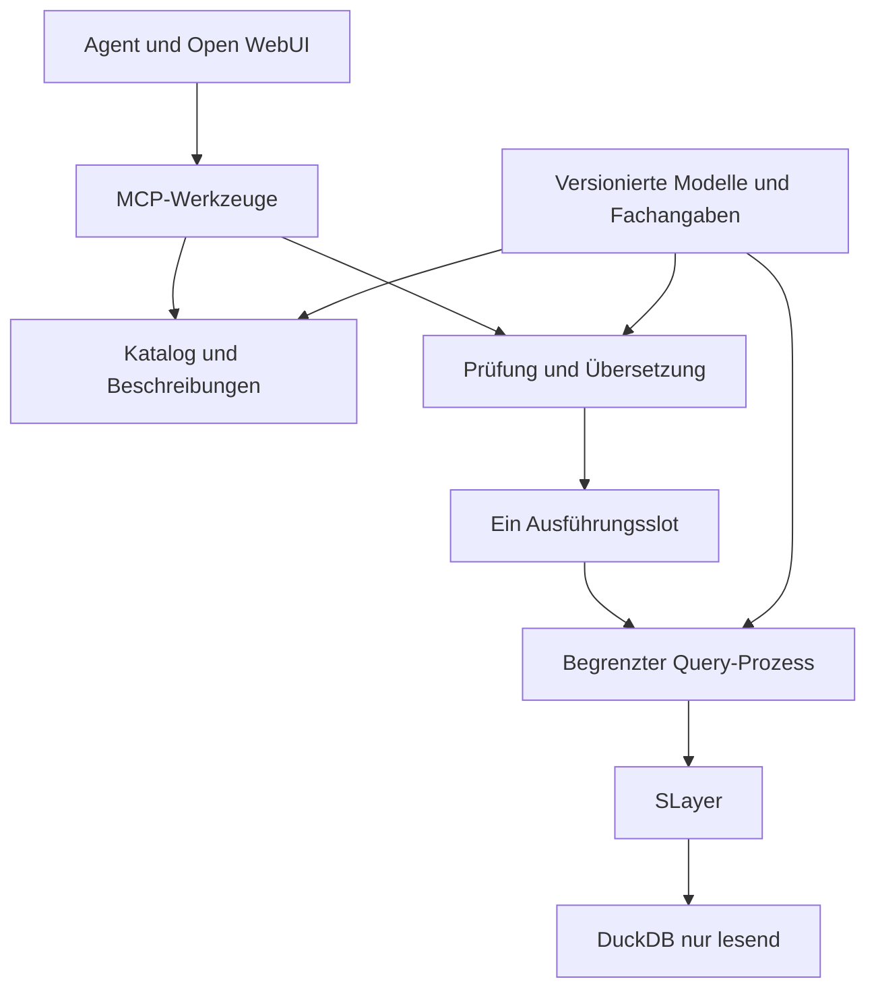

# Ziel und verbindliche Entscheidungen

**Detailspezifikation Version 1.0 · 23. Oktober 2026 · Zielgruppe LLM-Coding-Agent**

## 1 Ziel

Implementiere einen kleinen selbst betriebenen Python-Dienst für Conversational BI auf freigegebenen Daten des Kantons Solothurn. Ein Agent findet passende Daten und stellt neue Auswertungen selbständig zusammen. Die Anwendung prüft bekannte fachliche Grenzen und erzeugt native SLayer-Abfragen. SLayer berechnet das Ergebnis über eine lokale DuckDB-Datenbank.

> Der Agent darf alle fachlich möglichen Kombinationen selbständig verwenden, ohne dass wir jede einzelne Benutzerfrage vorhersehen müssen.

Die Aussage gilt innerhalb des ausdrücklich unterstützten Vertrags. Die erste Version umfasst Jahresdaten, additive Auswertungen innerhalb gültiger Ebenen, lokale Kategorieauswahl, Verhältnisse mit definiertem Nenner, ausgewählte Zeitvergleiche und den Durchschnitt von Jahrestotalen. Ihre Ausdrucksmittel sind allgemein kombinierbar. Sie sind keine Liste erlaubter Benutzerfragen.

Eine Berechnung kann mathematisch korrekt sein, obwohl eine freie Interpretation des Agenten falsch ist. Die Anwendung liefert deshalb verbindliche Definitionen, automatisch abgeleitete Ergebnisbeschreibungen und eine nachvollziehbare Formel. Sie verspricht keine allgemeine Prüfung beliebiger natürlichsprachlicher Behauptungen.

## 2 Normative Sprache

**MUSS** ist ein Abnahmekriterium. **SOLL** ist die bevorzugte einfache Umsetzung; eine Abweichung braucht einen konkreten technischen Grund und einen gleichwertigen Nachweis. **DARF** bezeichnet eine erlaubte Wahl. **SPÄTER** gehört ausdrücklich nicht zum Implementierungsauftrag dieser Version.

## 3 Technische Festlegungen

| Thema | Festlegung für Version 1 |
|---|---|
| Sprache | Python 3.12 |
| Semantische Engine | SLayer 1.4.1 aus Commit `516539dfec2979180695efa4351e0adccd6b2816` |
| Datenbank | Lokale DuckDB-Datei mit materialisierten Tabellen; im Dienst nur lesend geöffnet |
| Dateneingang | Geprüfte lokale Dateien und ein expliziter Vorbereitungsbefehl |
| Öffentliche Schnittstelle | Drei MCP-Werkzeuge über Streamable HTTP unter `/mcp` |
| Werkzeuge | `search`, `inspect`, `analyse` |
| Abfragevertrag | Kleiner typisierter Ausdrucksbaum; keine öffentliche native Query-/SQL-Durchreichung |
| Ausführung | Ein Serverprozess und bei Bedarf ein frischer Query-Unterprozess; höchstens eine Analyse gleichzeitig |
| Modellpflege | Versionierte SLayer-YAML-Dateien mit kleinen projektspezifischen `meta`-Angaben |
| Installation | `pyproject.toml`, `uv.lock`, nachvollziehbare Pins; keine eigene Build-Plattform |
| Tests | Pytest, reale eingefrorene Daten, unabhängige SQL-Orakel und gezielte Mutationen |
| Betrieb | Ein Container; eine Replik im ersten Stand; Health/Readiness, JSON-Logs, feste Grenzen |

Die genaue Paketbasis und tatsächlich geprüften APIs stehen in den Implementierungs- und Betriebsdokumenten. Ein Versionswechsel darf nicht nebenbei durch eine ungebundene Abhängigkeit erfolgen.

## 4 Bewusste Vereinfachungen

1. **Jahresdaten zuerst.** eBau-Monatsdaten sind als echte spätere Anforderung und negative Scope-Prüfung enthalten. Die Monats-/Quartals-API wird noch nicht implementiert.
2. **Offene Daten zuerst.** Es gibt in Version 1 keine Rollenverwaltung, Mandantenplattform oder allgemeine RLS-Verwaltung. Der Zugang kann durch ein bestehendes Gateway und einen einfachen Diensttoken geschützt werden.
3. **Keine Warteschlange.** Ist eine Analyse aktiv, liefert die nächste sofort einen definierten BUSY-Fehler. Der Prozesszustand bleibt einfach.
4. **Keine beliebigen Abfragestufen.** Die wenigen benötigten Berechnungsformen werden gezielt in SLayer übersetzt. Freie Query-DAGs und fremde Inline-Modelle sind nicht Teil der öffentlichen API.
5. **Keine zweite Datenmodellverwaltung.** Namen, Beziehungen und zusätzliche Fachangaben stehen bei den SLayer-Modellen. Ein kleiner beim Start erzeugter Index darf diese Angaben im Speicher erschliessen.
6. **Kein Ergebnis-Cache.** Die erste Version nutzt keinen eigenen Query-Cache und benötigt keinen Redis-Dienst.
7. **Keine automatische Katalogsynchronisation.** Die gelieferten XTF-/RDF-/DuckDB-Kataloge dienen dem Verständnis und der Herkunftsdokumentation. Die Anwendung muss diese Formate zur Laufzeit nicht importieren.
8. **Keine Embedding-Infrastruktur.** Suche verwendet den vorhandenen lexikalischen SLayer-Suchdienst und gepflegte deutsche Beschreibungen.
9. **Keine Datenkorrektur nach Gefühl.** Fehlerhafte optionale Modelle werden gesperrt; notwendige Kernmodelle müssen valide sein, bevor der Dienst bereit ist.

Eine zusätzliche Funktion ist erst dann gerechtfertigt, wenn sie einen konkreten Abnahmefall oder einen ausdrücklichen Folgeauftrag erfüllt. Vereinfachung darf keine falschen Zahlen, stillen Datenverlust oder einen behaupteten Schutz ohne wirksame Durchsetzung erzeugen.

## 5 Fachlicher Umfang

### Kernumfang

- Gemeindebevölkerung 2025 aus der Altersdatei als kanonische Bevölkerungsquelle.
- Fahrzeugbestand 2025 mit frei wählbaren Fahrzeugarten und klar getrennter Anzahl einzelner Fahrzeuge beziehungsweise Kennzahl mit Berücksichtigung von Wechselschildern.
- AV-Personal nach Jahr und Ausbildung.
- Nominaler AV-Umsatz nach Jahr.

### Mitgelieferte Erweiterungs- und Negativfälle

- GWS-Heizung und Gebäudekategorie als einfache zusätzliche Jahresmodelle, sobald ihre Schlüssel-/Abdeckungsprüfungen bestanden sind.
- Bevölkerung nach Geschlecht und Staatsangehörigkeit: reale fehlerhafte Datei, in Quarantäne.
- Steuererträge: anderer Gebietsstand; keine automatische räumliche Überführung.
- eBau: Monatsdaten mit Bestand und Bewegungszahl; ausserhalb des Jahresvertrags.

Quarantäne bedeutet: Originaldaten und Fehlernachweis bleiben erhalten; das Modell wird nicht als abfragbar angeboten. `inspect` kann erklären, warum ein bekanntes Modell nicht verfügbar ist. Die gesperrte Quelle darf die funktionierenden Kernmodelle nicht blockieren.

## 6 Architektur

Die Berechnungslogik bleibt in SLayer. Python darf Ergebnisse nach sichtbaren Jahren auswählen, umbenennen, sortieren, begrenzen und durch vorher definierte Qualitätsregeln als nicht berechenbar kennzeichnen. Python darf keine fehlgeschlagene SLayer-Berechnung durch selbst geschriebene Kennzahlberechnung oder SQL-Join-Planung ersetzen.

## 7 Änderungen gegenüber der Grobspezifikation

Die Grobspezifikation sah einen begrenzten nativen Query-Vertrag mit Prüfung der gebundenen SLayer-Ausdrücke vor. Die Detailspezifikation verkleinert diesen Eigenanteil: Der öffentliche Vertrag ist ein kleiner eigener Datenvertrag; daraus entstehen nur bekannte sichere native Formen. Ein allgemeiner Prüfer für jede mögliche SLayer-DSL- oder DAG-Form ist dadurch nicht nötig.

Die Autonomie bleibt erhalten: Der Agent darf bekannte Kennzahlen, Gruppierungen, lokale Filter, zulässige Operatoren und Bezugsgrössen frei kombinieren. Neu ist die ausdrückliche Grenze der zugelassenen Ausdrucksformen. Ein unbekanntes Konstrukt ergibt einen verständlichen Fehler, keine automatisch ausgeweitete Laufzeitbefugnis.

## 8 Definition von fertig

Die Anwendung ist fertig, wenn alle verbindlichen Fälle aus `04_DATEN_UND_ABNAHME.md` bestanden sind, die drei MCP-Werkzeuge gegen echte Daten funktionieren, ein Containerstart mit den vorgesehenen Dateirechten gelingt, Timeout und BUSY nachgewiesen sind und der Abschlussbericht verbleibende Grenzen nennt.

Ein bestandener SQL-Vergleich allein genügt nicht. Eine fertig ausgefüllte Spezifikation allein genügt ebenfalls nicht. Der Auftrag an den Coding-Agenten ist die lauffähige, nachvollziehbar geprüfte Umsetzung dieses begrenzten Umfangs.

## Quellen

- Vorangegangene Grobspezifikation und vertiefte Analyse, Version 0.2, 23. Oktober 2026.
- [SLayer am geprüften Commit](https://github.com/MotleyAI/slayer/tree/516539dfec2979180695efa4351e0adccd6b2816).
- [SLayer Python-Einbettung](https://docs.motley.ai/slayer/getting-started/python/), [Queries](https://docs.motley.ai/slayer/concepts/queries/), [Formeln](https://docs.motley.ai/slayer/concepts/formulas/).
- Eigene reale Datenstände und unabhängige Referenzabfragen im beigefügten Fixture-Paket.
